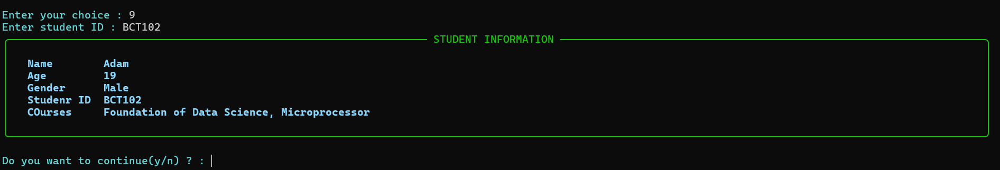

# University Management System

A Python-based university management system built around object-oriented programming principles. It handles the day-to-day entities of a university — students, professors, and courses — along with enrollment, grading, and record-keeping, all through a terminal interface powered by [Rich](https://github.com/Textualize/rich).

The goal of this project was to practice designing a system with real relationships between objects (students enroll in courses, professors get assigned to them, grades depend on both) rather than just writing isolated scripts. Data is persisted to JSON, so records survive between runs.

## Features

**Student management**
- Register students and maintain their records
- Enroll in and withdraw from courses
- Record marks and calculate grades
- View a student's full academic history

**Professor management**
- Register professors and maintain their records
- Assign and remove professors from courses
- View professor details and their course load

**Course management**
- Create courses with enrollment capacity limits
- Track which students and professors are attached to each course
- Prevent duplicate enrollments and over-capacity registration

**Search and statistics**
- Look up students, professors, or courses by various fields
- View overall university statistics (enrollment numbers, course loads, etc.)

**Data persistence**
- All records saved to and loaded from JSON
- Relationships between students, professors, and courses are preserved across sessions
- Gracefully handles missing or corrupted data files

**Error handling**
- Input validation throughout
- Custom exceptions for domain-specific errors (duplicate records, invalid enrollments, etc.)

## Concepts practiced

This project was as much about the exercise as the result. Things it covers:

- Classes, objects, and inheritance
- Encapsulation and modular design
- Custom exception handling
- File I/O and JSON serialization
- Input validation
- Modeling relationships between objects (not just standalone classes)

## Tech stack

- **Python 3.10+**
- **Rich** — for the console interface
- **JSON** — for data storage
- **Git/GitHub** — version control

## Project structure

```text
University-Management-System/
│
├── main.py              # Entry point
├── person.py            # Base class for Student/Professor
├── student.py
├── professor.py
├── course.py
├── university.py        # Top-level coordinator
├── searchrecord.py
├── storage.py           # JSON persistence layer
│
├── screenshots/
│   ├── main_menu.png
│   └── student_information.png
│
├── README.md
└── .gitignore
```

## Screenshots

**Main menu**


**Student information view**



## Getting started

### Requirements

- Python 3.10 or newer
- Git

### 1. Clone the repo

```bash
git clone https://github.com/Chandan13553/University-Management-System.git
cd University-Management-System
```

### 2. Install dependencies

```bash
pip install rich
```

### 3. Run it

```bash
python main.py
```

## Data storage

Records are stored in JSON files alongside the application, so nothing is lost between sessions — students, professors, courses, and the relationships between them all get reloaded automatically on startup.

## Possible next steps

A few things that would be worth adding down the line:

- A proper GUI instead of (or alongside) the console interface
- Swapping JSON for a real database (SQLite would be a natural first step)
- User authentication so different roles (admin, professor, student) see different things
- More detailed academic reporting — GPA trends, course-level statistics, etc.

## Author

**Chandan** — Computer Engineering student, working on Python and software development.

*Built as a hands-on way to practice object-oriented design and Python development beyond toy examples.*
